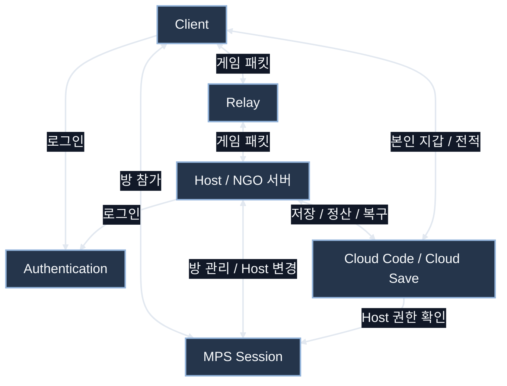
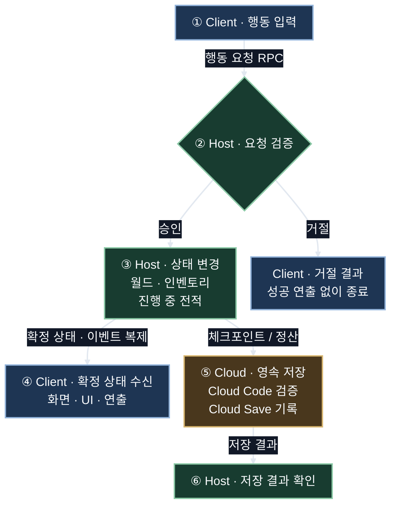
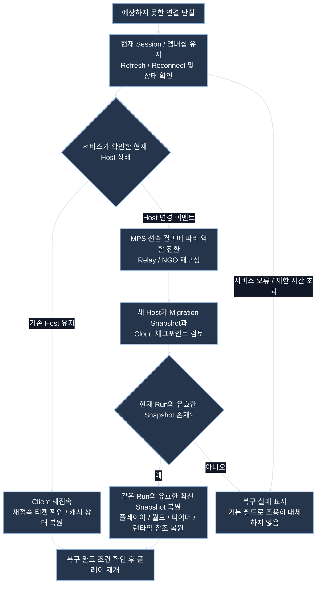

# EchoZone 네트워크 구조와 플레이 흐름

> GitHub 포트폴리오 문서 예시 · 구성 개편: 2026-10-17
>
> **전체 구조 → 로그인부터 탈출까지 한 사이클 → 기능별 상세 흐름 → 선택 이유와 검증 근거** 순서로 읽는다.
>
> 기존 코드 조사·검증 기록을 기반으로 흐름을 재구성했다. 이번 문서 편집은 새 게임 기능 구현이나 최신 빌드·Cloud 통합 검증을 뜻하지 않는다.

용어는 **정산 요청 접수 → 접수된 정산 요청 처리 재개 → 지급 결과 확인 → 탈출 완료**로 이어진다. 지갑의 `Revision`은 **지갑 변경 번호**, Snapshot의 `SnapshotVersion`은 **Snapshot 버전**으로 구분한다. **상태 복제**는 Host의 상태를 Client에 전달하는 것, **상태 복원**은 저장된 Snapshot을 적용하는 것을 뜻한다.

순서도는 위에서 아래로, 시퀀스는 왼쪽 시작 주체에서 오른쪽 처리 주체로 읽는다. 기능마다 한 그림을 기본으로 읽는다. 같은 흐름 안의 단계는 색상과 번호로 구분하며, 파랑은 시작·조회, 주황은 준비·검증, 초록은 적용·완료 영역이다.

## A. 전체 네트워크 구조

먼저 누가 누구와 연결되는지 본다. 화살표는 데이터가 오가는 관계이며 시간 순서는 다음 그림에서 설명한다.

| 구분 | 담당하는 일 |
|---|---|
| Client | 입력을 보내고 확정된 상태로 화면·UI를 갱신 |
| Host | 서버 권한으로 게임 판정, 월드·플레이어 원본 상태 관리 |
| Relay | 원격 Client와 Host 사이의 게임 패킷 중계 |
| MPS Session / Lobby | 방·멤버십 관리와 Host 변경 처리 |
| Authentication | 계정 인증과 PlayerId 제공 |
| Cloud Code / Cloud Save | 저장 요청 검증과 개인·월드 데이터 영속 저장 |

Host는 플레이어 PC에서 서버와 로컬 Client를 함께 실행한다. Relay는 게임 판정 서버가 아니며 Cloud Code도 실시간 물리·AI를 실행하는 게임 서버가 아니다. Host 변경 이벤트는 MPS Session에서 받는다. Relay가 독자적으로 새 Host를 선출하는 구조로 그리지 않는다.

## B. 로그인부터 탈출·돈 반영까지 한 사이클

이 그림은 플레이어 한 명의 **정상 진행 순서**다. 방 생성과 기존 방 참가는 서로 다른 진입 경로지만 접속 후 같은 플레이 흐름으로 합쳐진다.

```mermaid
%%{init: {"theme":"dark","themeVariables":{"fontSize":"18px","fontFamily":"sans-serif","primaryColor":"#1E3553","primaryTextColor":"#F8FAFC","primaryBorderColor":"#93B4DB","lineColor":"#DCE6F5","secondaryColor":"#183C30","tertiaryColor":"#49371D","clusterBkg":"#1E3553","clusterBorder":"#93B4DB","actorBkg":"#1E3553","actorBorder":"#93B4DB","actorTextColor":"#F8FAFC","signalColor":"#F8FAFC","signalTextColor":"#F8FAFC","labelBoxBkgColor":"#49371D","labelBoxBorderColor":"#D9B66F","labelTextColor":"#F8FAFC","loopTextColor":"#F8FAFC","noteBkgColor":"#25354B","noteTextColor":"#F8FAFC","noteBorderColor":"#93B4DB","textColor":"#F8FAFC","titleColor":"#F8FAFC","secondaryTextColor":"#F8FAFC","tertiaryTextColor":"#F8FAFC","edgeLabelBackground":"#111827","nodeTextColor":"#F8FAFC","actorLineColor":"#CBD5E1","activationBorderColor":"#CBD5E1","activationBkgColor":"#25354B","darkMode":true,"background":"#111827"},"flowchart":{"nodeSpacing":22,"rankSpacing":28,"padding":12},"sequence":{"actorMargin":24,"width":110,"height":44,"diagramMarginX":8,"diagramMarginY":12,"messageMargin":28,"mirrorActors":false,"wrap":true,"actorFontSize":18,"messageFontSize":18,"noteFontSize":17},"darkMode":true,"themeCSS":"text, tspan { fill: #F8FAFC !important; } .nodeLabel, .nodeLabel p, .nodeLabel span, .edgeLabel, .edgeLabel p, .cluster-label, .cluster-label p { color: #F8FAFC !important; } .messageText, .noteText, .labelText, .loopText { fill: #F8FAFC !important; color: #F8FAFC !important; } .messageLine0, .messageLine1, .actor-line { stroke: #E2E8F0 !important; }"}}%%
flowchart TD
    subgraph Entry["1. 로그인 · 입장"]
        L["① 로그인 / 회원가입<br/>Authentication에서 계정 확인"]
        W["② 개인 Cloud 지갑 준비<br/>기존 잔액 유지 · 없을 때만 생성"]
        Q{"③ 방 생성 또는 참가"}
        H["Host: Session 생성<br/>Relay / NGO Host 준비"]
        J["Client: 방 코드 참가<br/>Relay / NGO Client 연결"]
        Ready["④ 연결 승인 · 플레이어 준비<br/>현재 방 상태 적용"]
        L --> W --> Q
        Q -->|생성| H
        Q -->|참가| J
        H --> Ready
        J --> Ready
    end
    subgraph Play["2. 플레이 · 임시 상태"]
        Input["⑤ 행동 요청<br/>이동 · 전투 · 아이템 · 펫 절도"]
        Judge["⑥ Host 검증 / 판정<br/>월드 · 인벤토리 · 장물 · 세션 지갑 갱신"]
        Sync["⑦ 확정 상태 복제<br/>화면 / UI 반영 · 진행 중 전적 누적"]
        Input --> Judge --> Sync
    end
    subgraph Exit["3. 탈출 · 영속 정산"]
        E["⑧ 서버가 탈출 조건 확인<br/>금액 · 반납 목록 · 전적 요약 고정"]
        P["⑨ 정산 요청 접수<br/>정산 번호 고정 / 미완료 정산 요청 보존"]
        CP["⑩ 정산 준비 체크포인트 저장 확인"]
        Money["⑪ 접수된 정산 요청 처리 재개<br/>개인 잔액 반영 · 변경 번호 증가<br/>정산 영수증 보존"]
        Record["⑫ 완료 전적 확정<br/>돈 중복 지급 없이 전적 재시도"]
        Finish["⑬ 반납 / 장물 정리 후<br/>정산 완료 체크포인트 저장 확인"]
        Title["⑭ 탈출 성공 통지 · Session 퇴장<br/>타이틀 복귀 / 반영 잔액 조회"]
        E --> P --> CP --> Money --> Record --> Finish --> Title
    end
    Ready --> Input
    Sync -->|계속 플레이| Input
    Sync -->|탈출 시도| E
    style Entry fill:#1E3553,stroke:#93B4DB,stroke-width:3px,color:#F8FAFC
    style Play fill:#183C30,stroke:#8BC9A6,stroke-width:3px,color:#F8FAFC
    style Exit fill:#49371D,stroke:#D9B66F,stroke-width:3px,color:#F8FAFC
    classDef default fill:#25354B,stroke:#93B4DB,stroke-width:2px,color:#F8FAFC
    linkStyle default stroke:#E2E8F0,stroke-width:2px,color:#F8FAFC
```

**플레이 중 얻은 장물과 최종 Cloud 잔액은 구분한다.** 서버가 플레이 상태를 관리하다가 탈출 정산에서 개인 잔액을 확정한다. 이미 정산 영수증이 있는 정산 요청은 ⑨~⑪의 새 지급을 반복하지 않고 지급 결과를 확인한다. ⑪의 개인 잔액 반영과 ⑬의 정산 완료 체크포인트 저장 확인도 별도 단계다.

접속 중 주기적 Snapshot·체크포인트 저장은 위 정상 순서와 병행한다. 연결 장애는 다음 상세 문서의 재접속·Migration 경로로 빠진다. 실패했다고 다음 번호로 자동 진행하지 않는다.

## C. 기능별 상세 흐름

| 구분 | 확인할 내용 |
|---|---|
| C-1 로그인·접속 | 계정 인증, 지갑 준비, Host 생성 / Client 참가 |
| C-2 플레이 | 입력 요청, 서버 판정, 상태 복제, 전적 누적 |
| C-3 아이템 | 획득 검증, 동시 요청, 인벤토리 반영 |
| C-4 탈출·정산 | 정산 요청 접수·처리, 지급 결과 확인, 전적, 퇴장 |
| C-5 저장 | 임시 상태와 영속 데이터의 위치 |
| C-6 재접속 | 기존 Host를 유지한 Client 복귀 |
| C-7 Migration | Host 교체, Snapshot 검증·복원 |

### C-1. 로그인·지갑 준비·방 접속

```mermaid
%%{init: {"theme":"dark","themeVariables":{"fontSize":"20px","fontFamily":"sans-serif","primaryColor":"#1E3553","primaryTextColor":"#F8FAFC","primaryBorderColor":"#93B4DB","lineColor":"#DCE6F5","secondaryColor":"#183C30","tertiaryColor":"#49371D","clusterBkg":"#1E3553","clusterBorder":"#93B4DB","actorBkg":"#12243A","actorBorder":"#93B4DB","actorTextColor":"#FFFFFF","signalColor":"#FFFFFF","signalTextColor":"#FFFFFF","labelBoxBkgColor":"#49371D","labelBoxBorderColor":"#D9B66F","labelTextColor":"#FFFFFF","loopTextColor":"#FFFFFF","noteBkgColor":"#182A40","noteTextColor":"#FFFFFF","noteBorderColor":"#93B4DB","textColor":"#FFFFFF","titleColor":"#FFFFFF","secondaryTextColor":"#F8FAFC","tertiaryTextColor":"#F8FAFC","edgeLabelBackground":"#111827","nodeTextColor":"#F8FAFC","actorLineColor":"#E2E8F0","activationBorderColor":"#CBD5E1","activationBkgColor":"#25354B","darkMode":true,"background":"#111827"},"flowchart":{"nodeSpacing":22,"rankSpacing":28,"padding":12},"sequence":{"actorMargin":24,"width":110,"height":44,"diagramMarginX":8,"diagramMarginY":12,"messageMargin":32,"mirrorActors":false,"wrap":true,"actorFontSize":20,"messageFontSize":20,"noteFontSize":19,"actorFontWeight":700,"messageFontWeight":600,"noteFontWeight":700},"darkMode":true,"themeCSS":"text, tspan { fill: #FFFFFF !important; font-weight: 600 !important; } .messageText, .noteText, .labelText, .loopText { fill: #FFFFFF !important; color: #FFFFFF !important; font-weight: 600 !important; } .messageLine0, .messageLine1 { stroke: #FFFFFF !important; stroke-width: 2.5px !important; } .actor-line { stroke: #CBD5E1 !important; stroke-width: 1.5px !important; } marker path { fill: #FFFFFF !important; stroke: #FFFFFF !important; } .note, .labelBox { stroke: #AFC7E8 !important; stroke-width: 1.5px !important; }"}}%%
sequenceDiagram
    participant G as 게임
    participant A as 인증
    participant C as Cloud
    participant S as MPS / NGO
    rect rgb(18, 36, 58)
        Note over G,S: 1. 로그인
        G->>A: 로그인 / 회원가입
        A-->>G: PlayerId
    end
    rect rgb(45, 32, 15)
        Note over G,S: 2. 개인 지갑 준비
        G->>C: 개인 지갑 준비 요청<br/>EnsureOwnWallet
        C->>C: 기존 지갑 조회 / 누락 시만 생성
        C->>C: 지갑 저장 확인<br/>미완료 정산 요청 처리 재개
        C-->>G: 개인 지갑 준비 결과
    end
    rect rgb(13, 39, 29)
        Note over G,S: 3. 준비 성공 시 접속
        G->>S: 방 생성 또는 방 코드 참가
        S->>S: Relay / NGO 연결
        Note over G,S: Host는 생성 후 RunId 게시
        S-->>G: 연결 승인 / 플레이어 상태 준비
        G->>G: 게임 화면 표시
    end
```

파랑은 인증, 주황은 지갑 준비, 초록은 접속이다. **앞 단계가 실패하면 다음 구역으로 진행하지 않는다.** Cloud는 이 그림에서 Cloud Code와 Cloud Save를 묶은 표현이다. 지갑이 있을 때는 기존 잔액을 유지한다.

이 그림의 Session/Relay 내부 단계는 SDK 동작을 묶어 표현했다. 로그인 성공, Session 참가 성공, NGO 연결 성공, 플레이어 준비 완료는 서로 다른 완료 조건이다.

- 현재 진입점은 명시적 계정 로그인이다. 저장소에 남아 있는 이전 익명 인증 Service를 현재 로그인 흐름으로 오해하지 않는다.
- `PlayerId`는 계정 식별자, NGO `ClientId`는 현재 연결 식별자다. 재접속·Host 교체 후 ClientId가 바뀌어도 계정 연결은 PlayerId로 복원한다.
- 재접속과 Migration은 최초 지갑 생성 경로를 다시 실행해 잔액을 초기화하지 않는다.
- 최초 지갑 생성은 원자적인 create-if-absent가 아니다. 동일 계정 다중 PC·다중 방 사용을 안전하게 지원한다고 주장하지 않는다.

코드: [RelaySessionGlue](../Assets/Script/Online/Relay/RelaySessionGlue.cs), [WalletPreparation](../Assets/Script/Heist/WalletPreparation.cs), [WalletPreparationFunctions](../HostMigrationModule/Project/WalletPreparationFunctions.cs).

공식 근거: [MPS 네트워크 연결 관리](https://docs.unity.com/en-us/mps-sdk/manage-session-network-connection). 프로젝트의 지갑 사전 준비와 로딩 완료 조건은 프로젝트에서 추가한 처리다.

### C-2. 플레이: 요청 → 판정 → 상태 복제

**읽는 경로:** 맨 위의 Client 입력에서 시작해 아래로 읽는다. Host 검증·상태 변경 후 Client 확정 상태 수신과 Cloud 저장 경로로 나뉜다. 저장이 필요한 시점에는 Host → Cloud Code → Cloud Save 경로를 사용하고 결과를 Host가 확인한다. 두 경로는 목적이 다르며 매 행동마다 Cloud 저장을 기다리는 구조가 아니다. 거절된 요청은 성공 연출을 하지 않는다.

이동·사격·장비·펫 행동마다 구체적인 검증 조건은 다르다. 아이템은 C-3, Cloud 잔액 확정은 C-4에서 자세히 설명한다. 행동마다 Cloud에 쓰는 구조가 아니라 서버 메모리에서 진행하고 기존 체크포인트로 보존한다.

### C-3. 아이템 획득·인벤토리 반영

#### 요청·검증·결과 · 3개 참여자로 축소

```mermaid
%%{init: {"theme":"dark","themeVariables":{"fontSize":"20px","fontFamily":"sans-serif","primaryColor":"#1E3553","primaryTextColor":"#F8FAFC","primaryBorderColor":"#93B4DB","lineColor":"#DCE6F5","secondaryColor":"#183C30","tertiaryColor":"#49371D","clusterBkg":"#1E3553","clusterBorder":"#93B4DB","actorBkg":"#12243A","actorBorder":"#93B4DB","actorTextColor":"#FFFFFF","signalColor":"#FFFFFF","signalTextColor":"#FFFFFF","labelBoxBkgColor":"#49371D","labelBoxBorderColor":"#D9B66F","labelTextColor":"#FFFFFF","loopTextColor":"#FFFFFF","noteBkgColor":"#182A40","noteTextColor":"#FFFFFF","noteBorderColor":"#93B4DB","textColor":"#FFFFFF","titleColor":"#FFFFFF","secondaryTextColor":"#F8FAFC","tertiaryTextColor":"#F8FAFC","edgeLabelBackground":"#111827","nodeTextColor":"#F8FAFC","actorLineColor":"#E2E8F0","activationBorderColor":"#CBD5E1","activationBkgColor":"#25354B","darkMode":true,"background":"#111827"},"flowchart":{"nodeSpacing":22,"rankSpacing":28,"padding":12},"sequence":{"actorMargin":24,"width":110,"height":44,"diagramMarginX":8,"diagramMarginY":12,"messageMargin":32,"mirrorActors":false,"wrap":true,"actorFontSize":20,"messageFontSize":20,"noteFontSize":19,"actorFontWeight":700,"messageFontWeight":600,"noteFontWeight":700},"darkMode":true,"themeCSS":"text, tspan { fill: #FFFFFF !important; font-weight: 600 !important; } .messageText, .noteText, .labelText, .loopText { fill: #FFFFFF !important; color: #FFFFFF !important; font-weight: 600 !important; } .messageLine0, .messageLine1 { stroke: #FFFFFF !important; stroke-width: 2.5px !important; } .actor-line { stroke: #CBD5E1 !important; stroke-width: 1.5px !important; } marker path { fill: #FFFFFF !important; stroke: #FFFFFF !important; } .note, .labelBox { stroke: #AFC7E8 !important; stroke-width: 1.5px !important; }"}}%%
sequenceDiagram
    participant C as Client
    participant H as Host
    participant I as 아이템 규칙
    rect rgb(18, 36, 58)
        Note over C,I: 1. 아이템 획득 요청 검증
        C->>H: 아이템 획득 요청 / 대상 ID
        H->>H: 아이템 획득 요청 검증<br/>소유권 · 상태 · 범위
        H->>I: 잠금 안에서 획득 조건 재검사
        I-->>H: 획득 조건 검사 결과
    end
    rect rgb(13, 39, 29)
        Note over C,I: 2. 승인된 획득 요청 적용
        H->>I: 아이템 수량 · 인벤토리 변경
        H-->>C: 확정 상태 복제
        C->>C: 화면 / UI 반영
    end
```

**거절 경로:** 검증에 실패하거나 아이템이 소진되면 2번 초록 영역을 실행하지 않는다. 지급과 성공 연출을 확정하지 않는다. 원격 Client의 게임 패킷은 Relay를 경유한다.

핵심은 **클라이언트가 결과를 정하는 대신 행동을 요청하고, 서버가 최신 상태를 다시 검사하는 것**이다. 같은 아이템의 검사와 지급을 묶어 동시 획득의 중복 지급을 방지한다. 소유자 전용 인벤토리와 모든 플레이어가 보는 월드 상태는 복제 범위가 다르다.

이것은 상호작용의 대표 사례다. 이동·총기·장비마다 입력과 검증 조건이 다르므로 모든 RPC가 동일한 검사를 한다고 해석하지 않는다. Host에서 서버와 로컬 Client 이벤트가 겹치는 경우에도 효과를 중복 재생하지 않도록 확정 이벤트 경로를 사용한다.

코드: [PlayerInteractionGlue](../Assets/Script/Player/PlayerInteractionGlue.cs), [상호작용 잠금](../Assets/Script/Interaction/InteractionExecutionLock.cs), [ItemPickupInteractable](../Assets/Script/Interaction/ItemPickupInteractable.cs), [인벤토리 코드](../Assets/Script/Player/Inventory).

### C-4. 탈출·개인 잔액·완료 전적

**무엇을 하는가:** 탈출 보상을 개인 지갑에 한 번만 넣고, 지급과 복구용 저장을 확인한 뒤 장물을 정리하고 퇴장한다.

| 그림의 용어 | 쉬운 뜻과 역할 |
|---|---|
| `LoadWallet` | 지갑을 읽고, 미완료 정산 요청과 정산 영수증을 확인한다. 미완료 정산 요청의 처리를 재개할 수도 있다. |
| `PrepareEscape` | 정산 요청 접수. 누구에게 얼마를 지급할지 고정해 기록하며, 접수만으로 돈을 지급하지는 않는다. |
| `Pending` | 접수됐지만 처리가 끝나지 않은 정산 요청. 연결이 끊겨도 같은 내용을 이어서 처리하기 위한 기록이다. |
| `Revision` | 지갑의 변경 번호. 읽었을 때의 번호와 달라졌다면 오래된 잔액으로 덮어쓰지 않고 충돌을 처리한다. |
| 영수증 / `SettlementId` | 정산 영수증(지급 완료 기록) / 정산 번호(고유 ID). 같은 정산을 다시 요청해도 두 번 지급하지 않도록 대조한다. |
| 체크포인트 | Host 교체 등에 대비한 게임 상태 저장. 정산 준비와 장물 정리 완료 상태를 복구할 수 있게 남긴다. |

```mermaid
%%{init: {"theme":"dark","themeVariables":{"fontSize":"20px","fontFamily":"sans-serif","primaryColor":"#1E3553","primaryTextColor":"#F8FAFC","primaryBorderColor":"#93B4DB","lineColor":"#DCE6F5","secondaryColor":"#183C30","tertiaryColor":"#49371D","clusterBkg":"#1E3553","clusterBorder":"#93B4DB","actorBkg":"#12243A","actorBorder":"#93B4DB","actorTextColor":"#FFFFFF","signalColor":"#FFFFFF","signalTextColor":"#FFFFFF","labelBoxBkgColor":"#49371D","labelBoxBorderColor":"#D9B66F","labelTextColor":"#FFFFFF","loopTextColor":"#FFFFFF","noteBkgColor":"#182A40","noteTextColor":"#FFFFFF","noteBorderColor":"#93B4DB","textColor":"#FFFFFF","titleColor":"#FFFFFF","secondaryTextColor":"#F8FAFC","tertiaryTextColor":"#F8FAFC","edgeLabelBackground":"#111827","nodeTextColor":"#F8FAFC","actorLineColor":"#E2E8F0","activationBorderColor":"#CBD5E1","activationBkgColor":"#25354B","darkMode":true,"background":"#111827"},"flowchart":{"nodeSpacing":22,"rankSpacing":28,"padding":12},"sequence":{"actorMargin":24,"width":110,"height":44,"diagramMarginX":8,"diagramMarginY":12,"messageMargin":32,"mirrorActors":false,"wrap":true,"actorFontSize":20,"messageFontSize":20,"noteFontSize":19,"actorFontWeight":700,"messageFontWeight":600,"noteFontWeight":700},"darkMode":true,"themeCSS":"text, tspan { fill: #FFFFFF !important; font-weight: 600 !important; } .messageText, .noteText, .labelText, .loopText { fill: #FFFFFF !important; color: #FFFFFF !important; font-weight: 600 !important; } .messageLine0, .messageLine1 { stroke: #FFFFFF !important; stroke-width: 2.5px !important; } .actor-line { stroke: #CBD5E1 !important; stroke-width: 1.5px !important; } marker path { fill: #FFFFFF !important; stroke: #FFFFFF !important; } .note, .labelBox { stroke: #AFC7E8 !important; stroke-width: 1.5px !important; }"}}%%
sequenceDiagram
    participant H as Host
    participant C as Cloud Code
    participant D as Cloud Save
    rect rgb(18, 36, 58)
        Note over H,D: 1. 지급 결과 확인 / 정산 요청 접수
        H->>C: 정산 지갑 조회 요청<br/>LoadWallet
        C->>D: 미완료 정산 요청 / 정산 영수증 조회
        D-->>C: 정산 지갑 조회 결과
        C-->>H: 정산 지갑 조회 결과
        H->>H: 현재 세션 응답인지 확인<br/>정산 영수증 · 잔액 · 변경 번호 대조
        H->>H: 이미 지급됐는지 판단
        H->>C: 미지급이면 정산 요청 접수<br/>PrepareEscape
        C->>C: 정산 요청 검증<br/>권한 · 요청 내용 · 지갑 변경 번호
        C->>D: 미완료 정산 요청 보존<br/>Pending
        H->>C: 정산 준비 체크포인트 저장 요청
        C->>D: 정산 준비 체크포인트 저장
        C-->>H: 체크포인트 저장 결과
    end
    rect rgb(45, 32, 15)
        Note over H,D: 2. 접수된 정산 요청 처리 / 지급 결과 확인
        H->>C: 접수된 정산 요청 처리 재개<br/>LoadWallet
        C->>D: 개인 잔액 반영 / 변경 번호 증가<br/>정산 영수증 보존
        C->>D: 완료 전적 / 중복 검사
        C-->>H: 지급 결과 / 정산 영수증
        H->>H: 미완료 정산 요청 잔존 여부 검사<br/>정산 영수증 대조 / 지급 결과 확인
    end
    rect rgb(13, 39, 29)
        Note over H,D: 3. 월드 정리 / 탈출 완료
        H->>H: 반납 / 장물 정리
        H->>C: 정산 완료 체크포인트 저장 요청
        C->>D: 정산 완료 체크포인트 저장
        C-->>H: 체크포인트 저장 결과
        H->>H: 탈출 성공 통지 / Session 퇴장
    end
```

**파란색 구간 — 지급 결과 확인과 정산 요청 접수:** Host가 정산 지갑 조회 결과의 정산 영수증·잔액·변경 번호를 확인한다. 이미 지급됐다면 새 정산 요청 접수와 지급을 건너뛴다. 아직 미지급이면 정산 요청을 접수해 미완료 정산 요청(Pending)으로 보존하고, 정산 준비 체크포인트 저장 결과를 확인한다. 정산 요청 접수 자체는 지급이 아니지만, 앞의 조회는 기존 미완료 정산 요청의 처리를 재개할 수 있다.

**주황색 구간 — 접수된 정산 요청 처리 재개와 지급 결과 확인:** Cloud가 보존된 정산 요청을 처리해 개인 잔액·변경 번호·정산 영수증을 기록한다. 완료 전적을 확정한 뒤 Host가 지급 결과와 정산 영수증을 대조한다. 전적 저장 실패는 돈 재지급 없이 재시도한다.

**초록색 구간 — 월드 정리와 탈출 완료:** Host가 반납·장물 정리를 적용하고 정산 완료 체크포인트 저장 결과를 확인한 뒤 탈출 성공을 통지하고 Session을 퇴장한다.

**예시 — 잔액 1,000원에 장물 300원을 정산:** 정산 요청 접수 → 미완료 정산 요청·정산 준비 체크포인트 보존 → 접수된 정산 요청 처리 재개 → 개인 잔액 1,300원 반영·정산 영수증 보존 → 지급 결과 확인 → 월드 정리·정산 완료 체크포인트 저장 확인 → 탈출 완료. 돈 반영 후 응답만 끊겼다면 같은 정산 번호의 정산 영수증을 확인해 300원을 다시 지급하지 않는다.

가독성을 위해 정상 진행의 핵심 순서를 표현했다. 실제 재시도는 기존 영수증·Pending 존재 여부에 따라 앞 단계를 건너뛸 수 있다. 지갑·월드 체크포인트·전적 전체를 하나의 DB 트랜잭션으로 묶은 구조는 아니다.

- 응답이 유실되면 새 SettlementId로 지급하지 않고 기존 요청과 영수증을 대조한다.
- Revision과 Cloud Save writeLock은 동시 덮어쓰기를 감지한다. CAS는 비교한 버전이 유지된 경우에만 갱신하는 방식이다.
- 충돌이나 본문 불일치는 무조건 덮어쓰지 않는다. 재조회·재시도 또는 수동 확인이 필요하다.
- 전적 100회 보관은 표시용 정책이다. 정산 영수증 128건·200KB는 별도의 프로젝트 안전 제한이며 Unity Cloud 전체 한도가 아니다. 오래된 영수증의 안전한 보관·정리는 남은 운영 과제다.
- 로그인한 타이틀에서 본인 전적을 조회한다. 돈 지급과 전적 확정은 별도 단계이며, 전적 기능의 실계정 통합 검증은 아직 남아 있다.

코드: [PlayerWalletGlue](../Assets/Script/Heist/PlayerWalletGlue.cs), [WalletFunctions](../HostMigrationModule/Project/WalletFunctions.cs), [SettlementJournalBrick](../Assets/Script/Heist/SettlementJournalBrick.cs), [PlayHistoryFunctions](../HostMigrationModule/Project/PlayHistoryFunctions.cs).

공식 근거: [Cloud Save write locks](https://docs.unity.com/en-us/cloud-save/concepts/write-locks), [Cloud Code를 통한 데이터 저장](https://docs.unity.com/en-us/cloud-save/tutorials/cloud-code). 정산 ID와 저널의 업무 규칙은 프로젝트에서 직접 구현했다.

### C-5. 저장 데이터와 보존 위치

```mermaid
%%{init: {"theme":"dark","themeVariables":{"fontSize":"18px","fontFamily":"sans-serif","primaryColor":"#1E3553","primaryTextColor":"#F8FAFC","primaryBorderColor":"#93B4DB","lineColor":"#DCE6F5","secondaryColor":"#183C30","tertiaryColor":"#49371D","clusterBkg":"#1E3553","clusterBorder":"#93B4DB","actorBkg":"#1E3553","actorBorder":"#93B4DB","actorTextColor":"#F8FAFC","signalColor":"#F8FAFC","signalTextColor":"#F8FAFC","labelBoxBkgColor":"#49371D","labelBoxBorderColor":"#D9B66F","labelTextColor":"#F8FAFC","loopTextColor":"#F8FAFC","noteBkgColor":"#25354B","noteTextColor":"#F8FAFC","noteBorderColor":"#93B4DB","textColor":"#F8FAFC","titleColor":"#F8FAFC","secondaryTextColor":"#F8FAFC","tertiaryTextColor":"#F8FAFC","edgeLabelBackground":"#111827","nodeTextColor":"#F8FAFC","actorLineColor":"#CBD5E1","activationBorderColor":"#CBD5E1","activationBkgColor":"#25354B","darkMode":true,"background":"#111827"},"flowchart":{"nodeSpacing":22,"rankSpacing":28,"padding":12},"sequence":{"actorMargin":24,"width":110,"height":44,"diagramMarginX":8,"diagramMarginY":12,"messageMargin":28,"mirrorActors":false,"wrap":true,"actorFontSize":18,"messageFontSize":18,"noteFontSize":17},"darkMode":true,"themeCSS":"text, tspan { fill: #F8FAFC !important; } .nodeLabel, .nodeLabel p, .nodeLabel span, .edgeLabel, .edgeLabel p, .cluster-label, .cluster-label p { color: #F8FAFC !important; } .messageText, .noteText, .labelText, .loopText { fill: #F8FAFC !important; color: #F8FAFC !important; } .messageLine0, .messageLine1, .actor-line { stroke: #E2E8F0 !important; }"}}%%
flowchart TB
    Root["게임 데이터"]
    Root --> Live["실시간 상태"]
    Root --> Migration["Host 교체용 상태"]
    Root --> Persistent["영속 데이터"]
    Live --> HostMemory["Host 메모리<br/>월드 · 플레이어 원본<br/>진행 중 전적"]
    Live --> ClientView["Client 복제 / 로컬 표시<br/>수신 상태 · UI · 카메라"]
    Migration --> SessionData["MPS Migration Data<br/>RunId · SnapshotVersion<br/>플레이어 · 월드 Snapshot"]
    Persistent --> PlayerData["Protected Player Data<br/>PlayerId별 지갑<br/>정산 저널 · 완료 전적"]
    Persistent --> WorldData["Private Game Data<br/>RunId별 체크포인트<br/>월드 Snapshot"]
    classDef live fill:#1E3553,stroke:#93B4DB,color:#F8FAFC,stroke-width:2px
    classDef migration fill:#183C30,stroke:#8BC9A6,color:#F8FAFC,stroke-width:2px
    classDef persistent fill:#49371D,stroke:#D9B66F,color:#F8FAFC,stroke-width:2px
    class Live,HostMemory,ClientView live
    class Migration,SessionData migration
    class Persistent,PlayerData,WorldData persistent
    classDef default fill:#25354B,stroke:#93B4DB,stroke-width:2px,color:#F8FAFC
    linkStyle default stroke:#E2E8F0,stroke-width:2px,color:#F8FAFC
```

가지는 **현재 플레이에 쓰는 상태 / Host 교체에 전달하는 상태 / 종료 후에도 보존하는 상태**로 구분한다. 같은 Snapshot의 사본이 MPS와 Cloud에 각각 존재할 수 있다. Client에 수신한 게임 상태와 로컬 카메라·시스루는 같은 저장 대상이 아니며, 로컬 표시는 복구용 월드 원본으로 취급하지 않는다.

| 데이터 | 실시간 원본 / 저장 위치 | 식별·복원 기준 |
|---|---|---|
| 현재 월드·플레이어 상태 | Host 메모리, NGO 복제 | 현재 연결과 NetworkObject |
| Migration Snapshot | Host에서 수집 → MPS Migration Data | RunId, SnapshotVersion, 안정적인 개체 ID |
| 영속 월드 체크포인트 | Cloud Save Private Game Data | RunId별 Snapshot, 증가 버전, writeLock |
| 개인 확정 잔액 | Cloud Save Protected Player Data | 인증 PlayerId, Revision |
| 미완료 정산 요청·정산 영수증·회수 기록 | 개인 지갑의 영속 저널 | SettlementId, 고정 본문, 처리 단계 |
| 진행 중 전적 | 기존 세션 지갑 Snapshot 안의 playRecord | 개인 RoundId, 사건·건물 중복 제외 정보 |
| 완료 전적 | 개인 Protected 데이터의 별도 전적 목록 | PlayerId + RoundId, 최근 100회 보관 / 20회 조회 |
| 로컬 표시 | 각 Client의 카메라·시스루·UI | 로컬 오너 View. 이 목적만으로 RPC를 추가하지 않음 |

**Cloud를 썼다는 것은 저장소가 없다는 뜻이 아니다.** 직접 RDB 서버를 구축·운영하는 대신 관리형 Cloud Save의 키/값·JSON 저장과 Cloud Code의 검증 경로를 사용하는 구조다.

Host 메모리, MPS Migration Data, Cloud 체크포인트는 같은 시점에 원자적으로 저장되지 않는다. 마지막 Snapshot 이후 변경은 갑작스러운 종료에서 유실될 수 있으며, 무손실 복구를 보장한다고 설명하지 않는다. 개인 계속하기 분기·방 간 병합·오프라인 진행 정책은 AGENTS.md의 확장 기준이며, 이 문서에서 구현 완료로 포함하지 않는다.

### C-6. Client 재접속과 Host 교체의 분기

기존 Host가 살아 있는 Client 단절은 같은 Session을 유지한 연결 복구다. Host가 바뀐 경우에만 다음 Migration 절차로 들어간다. 유효한 티켓·캐시의 범위 밖 상태까지 무조건 복원된다고 가정하지 않는다.

### C-7. Host Migration: 같은 방의 상태 이어가기

```mermaid
%%{init: {"theme":"dark","themeVariables":{"fontSize":"20px","fontFamily":"sans-serif","primaryColor":"#1E3553","primaryTextColor":"#F8FAFC","primaryBorderColor":"#93B4DB","lineColor":"#DCE6F5","secondaryColor":"#183C30","tertiaryColor":"#49371D","clusterBkg":"#1E3553","clusterBorder":"#93B4DB","actorBkg":"#12243A","actorBorder":"#93B4DB","actorTextColor":"#FFFFFF","signalColor":"#FFFFFF","signalTextColor":"#FFFFFF","labelBoxBkgColor":"#49371D","labelBoxBorderColor":"#D9B66F","labelTextColor":"#FFFFFF","loopTextColor":"#FFFFFF","noteBkgColor":"#182A40","noteTextColor":"#FFFFFF","noteBorderColor":"#93B4DB","textColor":"#FFFFFF","titleColor":"#FFFFFF","secondaryTextColor":"#F8FAFC","tertiaryTextColor":"#F8FAFC","edgeLabelBackground":"#111827","nodeTextColor":"#F8FAFC","actorLineColor":"#E2E8F0","activationBorderColor":"#CBD5E1","activationBkgColor":"#25354B","darkMode":true,"background":"#111827"},"flowchart":{"nodeSpacing":22,"rankSpacing":28,"padding":12},"sequence":{"actorMargin":24,"width":110,"height":44,"diagramMarginX":8,"diagramMarginY":12,"messageMargin":32,"mirrorActors":false,"wrap":true,"actorFontSize":20,"messageFontSize":20,"noteFontSize":19,"actorFontWeight":700,"messageFontWeight":600,"noteFontWeight":700},"darkMode":true,"themeCSS":"text, tspan { fill: #FFFFFF !important; font-weight: 600 !important; } .messageText, .noteText, .labelText, .loopText { fill: #FFFFFF !important; color: #FFFFFF !important; font-weight: 600 !important; } .messageLine0, .messageLine1 { stroke: #FFFFFF !important; stroke-width: 2.5px !important; } .actor-line { stroke: #CBD5E1 !important; stroke-width: 1.5px !important; } marker path { fill: #FFFFFF !important; stroke: #FFFFFF !important; } .note, .labelBox { stroke: #AFC7E8 !important; stroke-width: 1.5px !important; }"}}%%
sequenceDiagram
    participant S as MPS
    participant H as 새 Host
    participant D as Cloud
    participant C as Client
    Note over S,D: 이전 Host가 Snapshot / 체크포인트를 주기적으로 보존
    rect rgb(18, 36, 58)
        Note over S,C: 1. Host 변경 / 네트워크 준비
        S-->>H: Host 변경 / Migration Data
        H->>H: Relay / NGO Host 준비
    end
    rect rgb(45, 32, 15)
        Note over S,C: 2. 검증 / 복원
        H->>D: 같은 Run의 Cloud 체크포인트 조회
        D-->>H: Cloud 체크포인트 조회 결과<br/>Snapshot / SnapshotVersion
        H->>H: Migration Snapshot과 비교<br/>유효한 최신 Snapshot 선택
        H->>D: 정산 지갑 / 정산 영수증 검증 요청
        D-->>H: 정산 지갑 검증 결과
        H->>H: 진행 차단 상태에서<br/>선택한 Snapshot 복원
        H->>H: 런타임 참조 재연결
    end
    rect rgb(13, 39, 29)
        Note over S,C: 3. Client 복귀 / 플레이 재개
        C->>S: 현재 Session 상태 조회
        S-->>C: 현재 Session 연결 정보
        C->>H: NGO 재연결
        H-->>C: 월드 / 플레이어 확정 상태 복제
        H->>H: 복구 완료 확인
        H->>D: 이후 체크포인트 저장 지속
    end
```

실제 SDK 콜백과 Client 재연결은 일부 겹칠 수 있다. 위 구역은 책임과 판정 단계를 나타내며 모든 Client가 복원 종료까지 대기한다는 뜻은 아니다. Snapshot·Cloud 영수증 검증 실패 시 복원 성공으로 진행하지 않는다.

MPS의 Host 선출과 프로젝트 게임 상태 복원은 별개다. `IMigrationDataHandler`는 Snapshot을 생성·수신하고, 프로젝트 Glue가 새 NGO Host 준비 이후 상태를 적용한다. 이 프로젝트의 NGO Snapshot 복원을 Unity가 자동으로 모두 제공한다고 설명하지 않는다.

- 방은 현재 Session의 WorldId·RunId를 이어받는다. 승격자의 개인 이전 저장으로 방을 덮어쓰지 않는다.
- Cloud 조회·저장은 방의 원래 생성자가 아니라 **현재 서비스 Host**인지 검사한다.
- 타이머는 이전 Host의 절대 실행 시각 대신 남은 시간으로 복원한다.
- 안정적인 개체·정의 ID와 카탈로그 호환성을 검사한다. 런타임 ClientId·대상 참조·작업 예약은 복원 시 다시 연결한다.
- 오래된 비동기 응답은 Session·operation·spawn 세대 검사로 배제한다.
- 현재 월드 Snapshot의 Cloud 영수증 확인을 할 수 없으면 오래된 월드를 임의 적용하지 않고 실패 처리한다. 연결 플레이어 지갑도 적용 전에 검증한다.
- 적용 이후 복구 보호 처리도 존재한다. 정확한 보호 대상·기간·종료 조건과 모든 Client 준비 장벽 여부는 실제 코드와 플레이 테스트로 따로 확인해야 한다.
- 새 Host가 없거나 유효 Snapshot이 없으면 복구가 불가능할 수 있다. 서비스 감지·선출 시간과 재연결·복원 시간은 별개이며 특정 초 안의 성공을 보장하지 않는다.

코드: [Session 데이터 핸들러](../Assets/Script/Online/Migration/HostMigrationSessionDataHandler.cs), [Snapshot 수집](../Assets/Script/Online/Migration/HostMigrationSnapshotCollector.cs), [Snapshot 적용](../Assets/Script/Online/Migration/HostMigrationSnapshotApplier.cs), [월드 복원](../Assets/Script/Online/Migration/SessionWorldMigrationGlue.cs), [재접속 캐시](../Assets/Script/Online/Reconnect/NetworkPlayerSessionCacheGlue.cs).

공식 근거: [MPS Host Migration](https://docs.unity.com/en-us/mps-sdk/session-host-migration). 최신 공식 페이지의 NGO Distributed Authority 안내와 본 프로젝트의 NGO Host/Client + 직접 작성한 Snapshot 복원을 혼동하지 않는다. 구현 API는 설치된 MPS 1.2.0 기준으로 확인했다.

## D. 기술 선택 이유

아래는 현재 구조를 설명하는 선택 근거 초안이다. 실제 비용·성능 측정 결과나 과거 의사결정 기록을 대신하지 않는다.

| 선택 | 해결하려는 문제 / 이점 | 대안과 트레이드오프 |
|---|---|---|
| NGO Host/Client | Unity 오브젝트와 서버 판정을 연결하고 별도 상시 게임 서버 운영 부담 축소 | 전용 서버는 신뢰성과 운영 통제가 높지만 구축·호스팅·배포 부담이 증가. Host의 성능·공정성에 의존 |
| MPS + Relay | 방 관리와 중계 연결을 SDK에 위임 | 직접 연결은 포트·NAT 대응이 필요. Relay는 비용·서비스 의존성이 있으며 게임 규칙 검증을 대신하지 않음 |
| Cloud Code + Cloud Save | 계정별 지갑과 Run JSON을 관리형 저장소에 보존하고 중요한 쓰기를 서버 함수로 제한 | 복잡한 관계·집계·다중 데이터 트랜잭션이 커지면 별도 백엔드와 RDB 검토. Cloud가 항상 더 싸거나 빠르다고 단정하지 않음 |
| Snapshot + 버전 | Host 메모리가 사라져도 마지막 보존 상태로 복원 | 저장 간격 사이 유실, 직렬화 비용, 버전 호환성, 복원 순서를 직접 관리해야 함 |
| Brick / Glue / Config | 규칙 테스트와 Unity·SDK 연결 책임 분리 | 파일과 연결 단계가 늘어나므로 기존 흐름에 최소 연결을 우선 |

RDB도 Cloud에서 운영할 수 있다. 비교 대상은 'DB 대 Cloud'가 아니라 '직접 설계한 관계형 저장·백엔드 대 현재의 관리형 키/값 저장·서버 함수'다.

## E. 보안·재시도·오류 대응

| 위험 | 현재 대응 / 설명 범위 | 남는 한계 |
|---|---|---|
| Client가 게임 결과 조작 | Host에서 요청 조건 재검사 후 권위 상태 변경 | 악의적인 Host가 서버 실행 코드를 조작하는 문제는 별개 |
| Client의 체크포인트 쓰기 | Cloud Code가 Lobby 현재 Host와 인증 호출자 비교 | 승인된 Host가 제출하는 월드 사실 전체를 Cloud가 재시뮬레이션하지 않음 |
| 지갑 직접 변조 | Protected 데이터에 Cloud 서버 권한으로 기록 | Endpoint별 검증과 실제 배포 접근 정책도 확인 필요 |
| 같은 정산 재전송 / 응답 유실 | SettlementId, 고정 본문, Pending·영수증, Revision / writeLock | 모든 저장소를 포괄하는 단일 원자 트랜잭션은 아님 |
| 재접속 식별자 재사용 | 서버 발급 재접속 티켓, 계정별 상태 캐시 | 최초 Payload의 PlayerId만으로 인증 토큰 검증이 끝났다고 주장하지 않음. 위조 저항성 별도 감사 필요 |
| 이전 요청이 새 방·UI에 반영 | Session 수명, generation, 스폰 세대 확인 | SDK HTTP 요청 자체가 반드시 취소되는 것은 아님 |
| 저장 실패 / 버전 충돌 | 실패 표시, 제한된 재시도 또는 수동 확인 | 실패를 지갑 없음이나 정상 완료로 바꾸지 않음 |

서버 권한이란 **어느 실행 주체가 최종 결정하는가**를 뜻한다. Host도 플레이어가 운영하므로 전용 서버 수준의 부정행위 방지를 의미하지 않는다. SHA-256 본문 해시는 동일 내용 확인에 쓰이며 비밀키 기반 서명이나 행동의 진실성을 증명하는 수단이 아니다.

## F. 검증 범위와 시연 계획

| 범위 | 근거 / 현재 해석 |
|---|---|
| 실제 Relay, 에디터 + 가상 플레이어 3인, 정상 Host Leave 2회 | [2026-10-01 검증 기록](RelayMigrationIntegrationVerification.md). RunId, 경찰·펫·건물·지갑·무기·아이템 복원 비교. 일부 상태 주입과 AI 일시 정지가 포함되어 전체 사용자 입력 종단 테스트는 아님 |
| 최신 전적 코드 | [2026-10-15 전적 보고서](PlayHistoryImplementation.md). 최신 Unity 컴파일, EditMode 154/154, Cloud 모듈 로컬 빌드 기록. 이 문서 작업에서 재실행한 결과가 아님 |
| 최신 전적 Cloud 배포 / 실계정 | 위 보고서에서 미실시. 소스 존재와 실제 서비스 반영을 구분 |
| 빌드 여러 개 실행 / Host 프로세스 강제 종료 | 기존 기록상 미검증. 별도 촬영·검증 예정 |
| 인터넷 단절 / 실제 다른 PC / 장기 장애 | 미검증 범위를 테스트 기록별로 확인해야 함 |
| 탈출 정산 중 Host 교체 / 실Cloud 경합 | 전체 조합 검증이 남아 있음. 단위 테스트를 실제 장애 복구 성공으로 표현하지 않음 |

과거 [복구 인수인계](SessionRecoveryHandoff.md)에는 당시 미구현·제한 항목이 있다. 이후 상태 범위가 확장되었으므로 과거 문서의 제한을 현재 소스 확인 없이 그대로 적용하지 않는다.

### 빌드 시연에서 확보할 증거

1. 서로 다른 계정의 Host와 Client 빌드를 같은 방에 접속한다.
2. RunId, 플레이어·펫·경찰·건물·아이템·지갑 등의 비교 상태를 기록한다.
3. 정상 Leave와 Host 프로세스 강제 종료를 각각 시험한다.
4. 선출·Relay 전환·Snapshot 적용·Client 재연결·플레이 재개를 구분해 확인한다.
5. 새 Host가 저장을 이어가고 중복 지급·중복 개체가 없는지 확인한다.
6. 실패 시 로그와 재현 순서를 남기고, 실제로 확인한 범위만 영상 자막에 기재한다.

같은 PC 전체의 네트워크를 끊으면 모든 빌드가 함께 영향을 받는다. 이를 Host만 단절되거나 Client만 단절된 시험으로 해석하지 않는다.

## G. 면접에서 설명하는 순서

> “EchoZone은 NGO Host/Client 구조입니다. Client가 행동을 요청하면 Host가 판정하고 상태를 복제합니다. Relay는 연결 중계, MPS는 방과 Host 변경을 담당합니다. 개인 잔액과 월드 체크포인트는 Cloud Code 검증을 거쳐 Cloud Save에 저장합니다. Host 교체 시에는 제가 작성한 Snapshot 수집·검증·복원 코드로 현재 Run을 이어갑니다. 정산은 ID·영수증·버전으로 재시도에 대응하지만 악의적인 Host 방어와 모든 장애 조합의 검증까지 완료했다고 주장하지는 않습니다.”

이어지는 질문에는 구조도 → 해당 시퀀스 → 코드 → 검증 기록 순서로 설명한다. PPT에는 A의 전체 구조, B의 정상 플레이 순서, C-7의 Migration을 우선 사용하고, 나머지는 GitHub 상세 문서에서 확인하도록 연결할 수 있다.

공식 문서 확인일: 2026-10-15. 공식 문서는 서비스 원리와 API 근거이며 프로젝트 통합 테스트의 성공 증거가 아니다.

## H. 세부 구성요소와 코드 근거

서비스별 기술·버전과 Migration Data 경로 펼치기

### 서비스별 상세 구조

주요 서비스 관계는 A의 구조도에 통합했다. Host가 생성한 Snapshot은 MPS Migration Data에 보존하고 새 Host로 전달한다. Cloud Code는 현재 Session Host를 확인한 뒤 개인 Protected 데이터와 Run별 Private Game Data를 읽고 쓴다.

A의 화살표는 통신·데이터 관계를 나타내며 물리적인 Unity 서버 배치를 뜻하지 않는다. Host의 로컬 플레이어는 같은 프로세스 안의 서버를 사용하므로 별도 원격 Client와 연결 경로가 다르다.

**Relay는 게임 규칙을 실행하지 않는다.** 체력, 아이템, 절도와 전투 판정은 Host의 NGO 서버에서 수행한다. Cloud Code도 매 프레임 물리·AI를 실행하는 전용 게임 서버가 아니다.

| 기술 | 프로젝트에서 맡은 책임 | 확인 근거 |
|---|---|---|
| NGO 2.7.0 | RPC, NetworkObject, 상태 복제 | [패키지 설정](../Packages/manifest.json), [플레이어 네트워크 코드](../Assets/Script/Player/Network) |
| Multiplayer Services 1.2.0 | Session 생성·코드 참가, Relay 및 Migration 연결 | [UnityRelaySessionService](../Assets/Script/Online/Relay/UnityRelaySessionService.cs) |
| Authentication 3.7.4 | 아이디·비밀번호 로그인/회원가입, PlayerId | [계정 인증 Service](../Assets/Script/Online/Authentication/UnityAccountAuthenticationService.cs) |
| Cloud Code 2.10.2 | 현재 Host 확인, 지갑·정산·체크포인트 처리 | [Cloud 모듈 소스](../HostMigrationModule/Project) |
| Cloud Save 3.4.1 | 개인 데이터와 Run 체크포인트 영속 저장 | [HostMigrationFunctions](../HostMigrationModule/Project/HostMigrationFunctions.cs), [WalletFunctions](../HostMigrationModule/Project/WalletFunctions.cs) |

버전은 설치 선언 기준이다. Unity Transport의 실제 설치 버전과 전송 프로토콜 설정은 별도로 확인해야 하며, 여기서는 TCP/UDP/DTLS 사용 여부를 추정해 표기하지 않았다.

