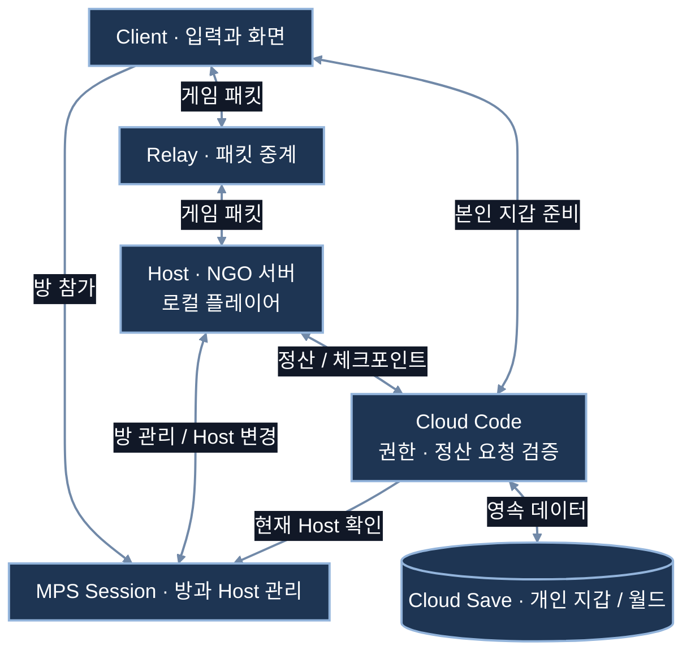
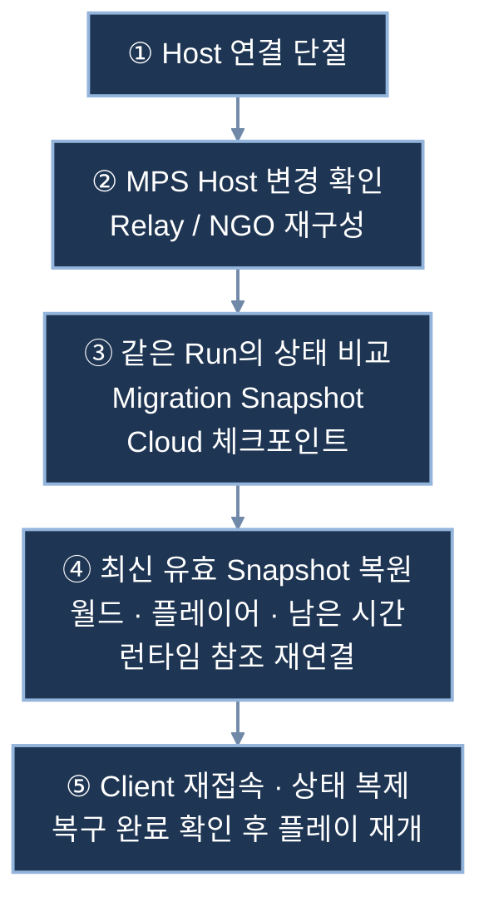
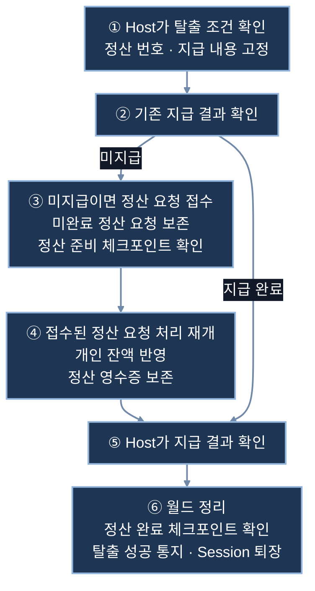

# EchoZone

도시에서 펫에게 절도를 지시하고, 경찰의 수색을 피해 장물을 회수·정산하는 **PC 온라인 하이스트 게임**입니다.

Relay 기반 Host / Client 구조로 게임 판정과 상태 복제를 연결하고, Host 교체 시 월드 복원과 탈출 보상의 Cloud 정산을 구현했습니다.

## 시연 영상

**[▶ EchoZone 플레이 영상 보기](https://youtu.be/tE5l8Fiq7lM)**

## 핵심 플레이와 기능

**로그인·방 접속 → 펫 획득·절도 지시 → 경찰 수색·교전 → 장물 회수 → 탈출·개인 잔액 반영**

| 플레이 요소 | 구현 내용 |
|---|---|
| 펫 절도 | 건물로 이동해 장물을 싣고 복귀하며, 등급과 적재량에 따라 이동 속도가 달라집니다. |
| 경찰 대응 | 순찰·소리 인지·시야 확인·현장 조사·추격·전투를 연결하고, 절도 증거와 공격에 따라 수배를 처리합니다. |
| 장비와 아이템 | 무기·방어구·탄약의 구매·판매·장착, 월드 아이템과 사망 시 남는 Loot Bag 획득을 지원합니다. |
| 탈출 | 서버가 확정한 장물과 반납 목록으로 개인 지갑을 정산하고 타이틀로 복귀합니다. |
| 화면과 연출 | 카메라 줌·건물 시스루, 인벤토리·수배 UI와 서버 확정 이벤트에 따른 효과음·총구 섬광을 연결했습니다. |

[경찰 행동 설계](Docs/PoliceInvestigationAndRetaliation.md) · [장비·상점 설계](Docs/EquipmentShopImplementation.md)

플레이 방법

| 입력 | 기능 |
|---|---|
| `WASD` / 방향키 | 카메라 기준 이동 |
| 마우스 이동 / 왼쪽 버튼 | 조준 / 사격 |
| `R` | 재장전 |
| `F` | 아이템 획득, 펫·건물 상호작용 |
| `I` | 인벤토리·장비 UI |
| 마우스 휠 / 클릭 | 카메라 확대·축소 / UI 조작 |

로그인 후 Host가 방을 생성하면, Client는 방 코드로 참가합니다.

## 네트워크 구조와 문제 해결

### 전체 구조 — 연결·게임 판정·저장의 역할 분리

별도 상시 게임 서버의 운영 부담을 줄이기 위해 Host 구조를 사용하고, 방 관리와 연결 중계는 MPS·Relay에 맡겼습니다. 계정 인증은 Unity Authentication이 담당하며, 게임 판정은 Host, 중요한 저장 요청의 검증은 Cloud Code가 담당합니다.

공식 문서: [Session 네트워크 연결](https://docs.unity.com/en-us/mps-sdk/manage-session-network-connection) · [Relay와 Lobby의 역할](https://docs.unity.com/en-us/mps-sdk/advanced-config/relay-vs-lobby)

### 서버 권한 — 요청과 확정 결과 분리

```mermaid
%%{init: {"theme":"dark","themeVariables":{"fontSize":"18px","fontFamily":"sans-serif","darkMode":true,"background":"#111827","primaryColor":"#1E3553","primaryTextColor":"#FFFFFF","primaryBorderColor":"#93B4DB","lineColor":"#7189A8","textColor":"#FFFFFF","actorBkg":"#12243A","actorBorder":"#93B4DB","actorTextColor":"#FFFFFF","signalColor":"#FFFFFF","signalTextColor":"#FFFFFF","actorLineColor":"#7189A8","noteBkgColor":"#182A40","noteTextColor":"#FFFFFF","noteBorderColor":"#93B4DB","edgeLabelBackground":"#111827"},"flowchart":{"nodeSpacing":24,"rankSpacing":28,"padding":12,"wrappingWidth":300},"sequence":{"actorMargin":30,"width":120,"height":44,"messageMargin":28,"mirrorActors":false,"wrap":true,"actorFontSize":19,"messageFontSize":18,"noteFontSize":18},"themeCSS":"text, tspan { fill: #FFFFFF !important; } .nodeLabel, .nodeLabel p, .edgeLabel, .edgeLabel p { color: #FFFFFF !important; } .messageText, .noteText { fill: #FFFFFF !important; } .messageLine0, .messageLine1 { stroke: #FFFFFF !important; stroke-width: 2px !important; } .actor-line { stroke: #7189A8 !important; }"}}%%
sequenceDiagram
    participant C as Client
    participant H as Host
    participant G as 게임 규칙
    rect rgb(18, 36, 58)
        C->>H: 아이템 획득 요청
        H->>H: 소유권 / 생존 / 범위 검증
        H->>G: 잠금 안에서<br/>획득 조건 재검사
        G-->>H: 아이템 · 인벤토리<br/>변경 결과
    end
    rect rgb(13, 39, 29)
        H-->>C: 승인된 확정 상태 복제
        C->>C: 화면 / UI / 확정 연출 반영
    end
```

같은 아이템의 조건 검사와 지급을 하나의 임계 구역으로 묶고, 서버의 최신 수량을 기준으로 처리해 중복 획득을 방지합니다. 실패한 요청은 지급으로 이어지지 않으며, 인벤토리는 소유자에게 복제하고 성공 연출은 서버 확정 이후 전달해 Host의 중복 재생을 피합니다.

공식 문서: [NGO 2.7 RPC와 실행 권한](https://docs.unity.cn/Packages/com.unity.netcode.gameobjects@2.7/manual/advanced-topics/message-system/rpc.html) · [상세 요청·복제 흐름](Docs/NetworkArchitectureExample.md#c-3-아이템-획득인벤토리-반영)

### Host Migration — 새 Host 선출 이후의 게임 상태 복원

새 Host 선출만으로는 이전 Host 메모리의 월드가 복구되지 않으므로, 프로젝트에서 Snapshot 수집·검증·복원 처리를 작성했습니다. 현재 방의 Run을 유지하고 남은 시간과 안정적인 개체 ID로 상태를 복원하며, 이전 세션의 늦은 응답은 세대 검사로 차단합니다.

공식 문서: [MPS Host Migration](https://docs.unity.com/en-us/mps-sdk/session-host-migration) · [프로젝트 복원 흐름](Docs/NetworkArchitectureExample.md#c-7-host-migration-같은-방의-상태-이어가기)

### Cloud 정산 — 응답이 끊겨도 같은 보상을 다시 지급하지 않기

응답 유실로 지급 여부를 알 수 없어도 같은 정산 번호와 영수증을 대조하며, 지갑 변경 번호와 조건부 저장으로 오래된 값의 덮어쓰기를 막습니다. 직접 RDB 서버를 운영하는 대신 계정별 지갑과 Run별 월드를 Cloud Save에 보존하고 Cloud Code로 쓰기를 검증하지만, 지갑·월드·전적을 하나의 트랜잭션으로 묶은 구조는 아닙니다.

공식 문서: [Cloud Code를 통한 데이터 저장](https://docs.unity.com/en-us/cloud-save/tutorials/cloud-code) · [Cloud Save 조건부 저장](https://docs.unity.com/en-us/cloud-save/concepts/write-locks) · [상세 정산·용어 설명](Docs/NetworkArchitectureExample.md#c-4-탈출개인-잔액완료-전적)

### 코드 구조 — Brick · Glue · Config

**Brick은 계산·판정·상태 전이, Glue는 Unity·네트워크·UI 연결, Config는 수치와 에셋 참조**를 담당합니다. 중앙 갱신의 `ManualUpdate`와 확정 이벤트를 재사용하고, 저장에는 안정적인 정의·개체 ID를 사용해 런타임 참조와 분리했습니다.

[전체 흐름·저장 위치·설계 선택 보기](Docs/NetworkArchitectureExample.md)

## 개발 환경과 실행 참고

| 구분 | 사용 기술 |
|---|---|
| Editor / 플랫폼 | Unity 6.3 LTS · 6000.3.19f1 / PC |
| 네트워크 | NGO 2.7.0 · MPS 1.2.0 · Relay / Lobby · Authentication 3.7.4 |
| Cloud | Cloud Save 3.4.1 · Cloud Code 2.10.2 |
| 게임·화면 | AI Navigation 2.0.13 · URP 17.3.0 · Input System 1.19.0 · uGUI / TextMesh Pro |
| 개발 도구 | Multiplayer Play Mode 1.3.3 |

`Assets/Scenes/Kenney_City2x2_Online.unity`에서 온라인 플레이를 시작합니다. 다른 Unity Cloud 프로젝트로 실행하려면 Services 연결, 계정 인증, Cloud Code 모듈 배포와 Host Migration의 Dashboard 설정을 해당 환경에 맞춰야 합니다.

Host 구조는 플레이어 PC의 성능과 신뢰성에 의존하며, 전용 서버 수준의 부정행위 방지를 제공하지 않습니다. Host 선출 시간은 서비스 설정에 영향을 받고, 마지막 체크포인트 이후의 변경까지 무손실 복구하는 구조는 아닙니다.
