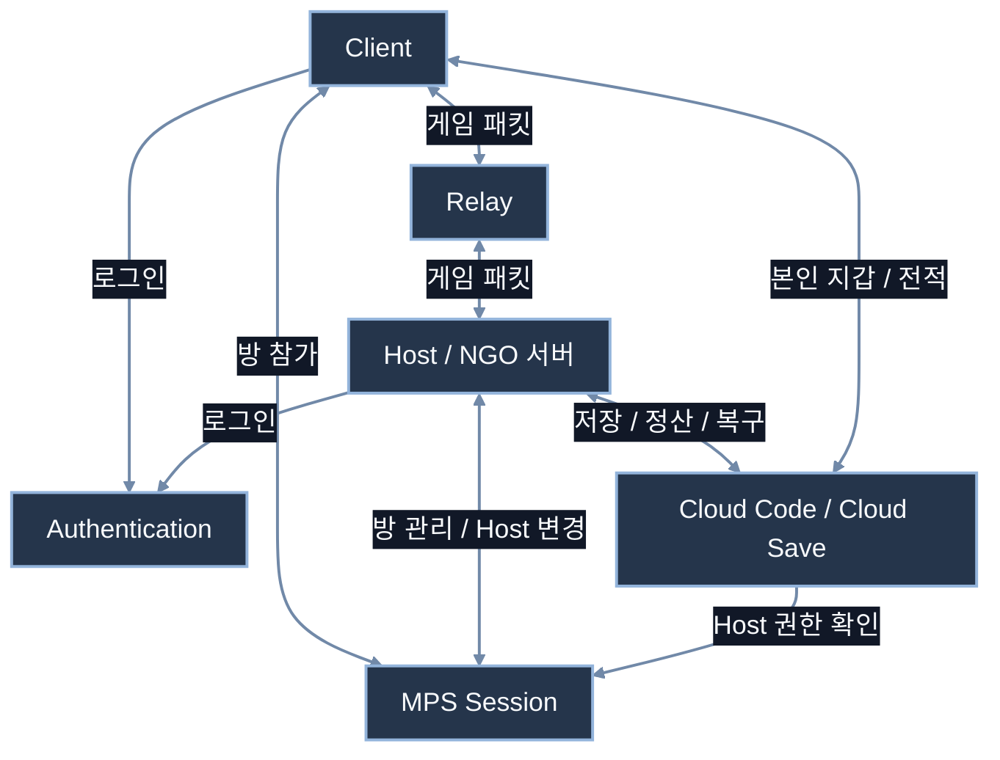
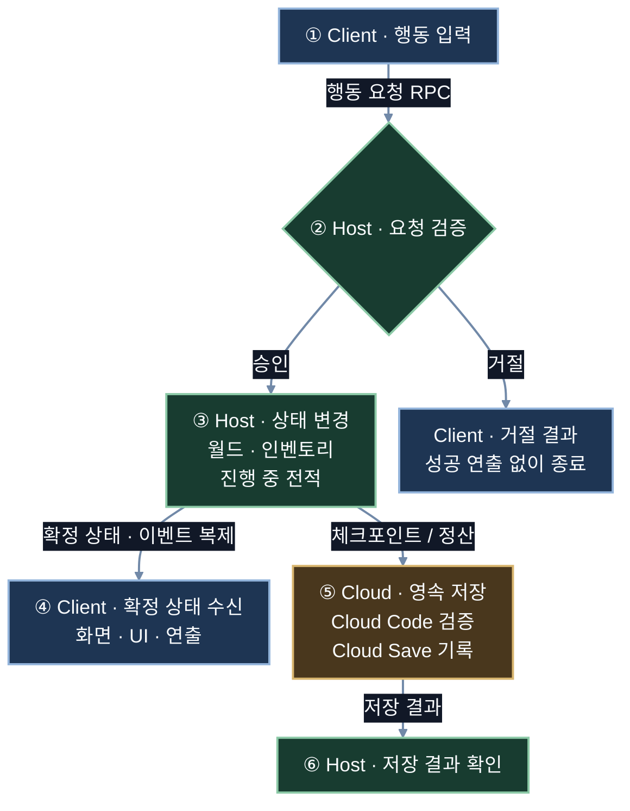
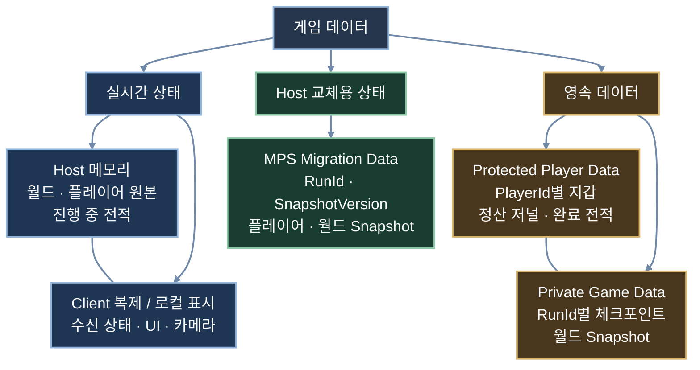
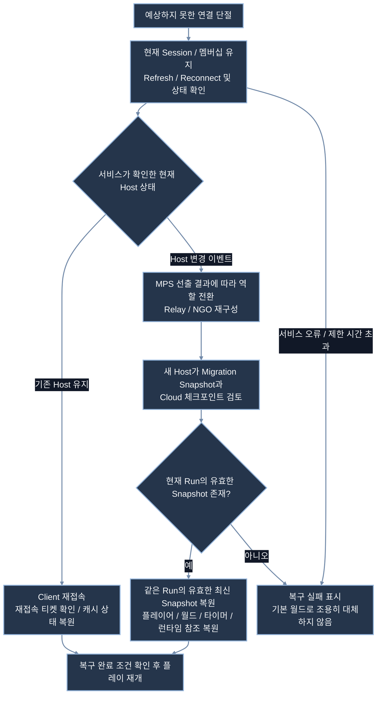

# EchoZone

도시에서 펫에게 절도를 지시하고, 경찰의 수색을 피해 장물을 회수·정산하는 **PC 온라인 하이스트 게임**입니다.

Relay 기반 Host / Client 구조로 게임 판정과 상태 복제를 연결하고, Host 교체 시 월드 복원과 탈출 보상의 Cloud 정산을 구현했습니다.

## 시연 영상

**[▶ EchoZone 플레이 영상 보기](https://youtu.be/tE5l8Fiq7lM)**

## 핵심 플레이와 기능

**로그인·방 접속 → 펫 획득·절도 지시 → 경찰 수색·교전 → 장물 회수 → 탈출·개인 잔액 반영**

| 플레이 요소 | 구현 내용 |
|---|---|
| 펫 절도 | 건물로 이동해 장물을 싣고 복귀하며, 등급과 적재량에 따라 이동 속도가 달라집니다. |
| 경찰 대응 | 순찰·소리 인지·시야 확인·현장 조사·추격·전투를 연결하고, 절도 증거와 공격에 따라 수배를 처리합니다. |
| 장비와 아이템 | 무기·방어구·탄약의 구매·판매·장착, 월드 아이템과 사망 시 남는 Loot Bag 획득을 지원합니다. |
| 탈출 | 서버가 확정한 장물과 반납 목록으로 개인 지갑을 정산하고 타이틀로 복귀합니다. |
| 화면과 연출 | 카메라 줌·건물 시스루, 인벤토리·수배 UI와 서버 확정 이벤트에 따른 효과음·총구 섬광을 연결했습니다. |

플레이 방법

| 입력 | 기능 |
|---|---|
| `WASD` / 방향키 | 카메라 기준 이동 |
| 마우스 이동 / 왼쪽 버튼 | 조준 / 사격 |
| `R` | 재장전 |
| `F` | 아이템 획득, 펫·건물 상호작용 |
| `I` | 인벤토리·장비 UI |
| 마우스 휠 / 클릭 | 카메라 확대·축소 / UI 조작 |

로그인 후 Host가 방을 생성하면, Client는 방 코드로 참가합니다.

## 네트워크 구조와 전체 흐름

### A. 전체 네트워크 구조

상시 게임 서버의 운영 부담을 줄이기 위해 Host 구조를 사용하고, 계정 인증·방 관리·패킷 중계는 Unity 서비스에 맡겼습니다. Host는 게임을 판정하고, Cloud Code는 중요한 저장 요청을 검증하며 Cloud Save에 기록합니다.

공식 문서: [MPS 네트워크 연결](https://docs.unity.com/en-us/mps-sdk/manage-session-network-connection) · [Relay와 Lobby의 역할](https://docs.unity.com/en-us/mps-sdk/advanced-config/relay-vs-lobby)

### B. 로그인부터 탈출·개인 잔액 반영까지

```mermaid
%%{init: {"theme":"dark","themeVariables":{"fontSize":"18px","fontFamily":"sans-serif","primaryColor":"#1E3553","primaryTextColor":"#F8FAFC","primaryBorderColor":"#93B4DB","lineColor":"#7189A8","secondaryColor":"#183C30","tertiaryColor":"#49371D","clusterBkg":"#1E3553","clusterBorder":"#93B4DB","actorBkg":"#1E3553","actorBorder":"#93B4DB","actorTextColor":"#F8FAFC","signalColor":"#F8FAFC","signalTextColor":"#F8FAFC","labelBoxBkgColor":"#49371D","labelBoxBorderColor":"#D9B66F","labelTextColor":"#F8FAFC","loopTextColor":"#F8FAFC","noteBkgColor":"#25354B","noteTextColor":"#F8FAFC","noteBorderColor":"#93B4DB","textColor":"#F8FAFC","titleColor":"#F8FAFC","secondaryTextColor":"#F8FAFC","tertiaryTextColor":"#F8FAFC","edgeLabelBackground":"#111827","nodeTextColor":"#F8FAFC","actorLineColor":"#CBD5E1","activationBorderColor":"#CBD5E1","activationBkgColor":"#25354B","darkMode":true,"background":"#111827"},"flowchart":{"nodeSpacing":22,"rankSpacing":28,"padding":12},"sequence":{"actorMargin":24,"width":110,"height":44,"diagramMarginX":8,"diagramMarginY":12,"messageMargin":28,"mirrorActors":false,"wrap":true,"actorFontSize":18,"messageFontSize":18,"noteFontSize":17},"darkMode":true,"themeCSS":"text, tspan { fill: #F8FAFC !important; } .nodeLabel, .nodeLabel p, .nodeLabel span, .edgeLabel, .edgeLabel p, .cluster-label, .cluster-label p { color: #F8FAFC !important; } .messageText, .noteText, .labelText, .loopText { fill: #F8FAFC !important; color: #F8FAFC !important; } .messageLine0, .messageLine1, .actor-line { stroke: #E2E8F0 !important; }"}}%%
flowchart TD
    subgraph Entry["1. 로그인 · 입장"]
        L["① 로그인 / 회원가입<br/>Authentication에서 계정 확인"]
        W["② 개인 Cloud 지갑 준비<br/>기존 잔액 유지 · 없을 때만 생성"]
        Q{"③ 방 생성 또는 참가"}
        H["Host: Session 생성<br/>Relay / NGO Host 준비"]
        J["Client: 방 코드 참가<br/>Relay / NGO Client 연결"]
        Ready["④ 연결 승인 · 플레이어 준비<br/>현재 방 상태 적용"]
        L --> W --> Q
        Q -->|생성| H
        Q -->|참가| J
        H --> Ready
        J --> Ready
    end
    subgraph Play["2. 플레이 · 임시 상태"]
        Input["⑤ 행동 요청<br/>이동 · 전투 · 아이템 · 펫 절도"]
        Judge["⑥ Host 검증 / 판정<br/>월드 · 인벤토리 · 장물 · 세션 지갑 갱신"]
        Sync["⑦ 확정 상태 복제<br/>화면 / UI 반영 · 진행 중 전적 누적"]
        Input --> Judge --> Sync
    end
    subgraph Exit["3. 탈출 · 영속 정산"]
        E["⑧ 서버가 탈출 조건 확인<br/>금액 · 반납 목록 · 전적 요약 고정"]
        P["⑨ 정산 요청 접수<br/>정산 번호 고정 / 미완료 정산 요청 보존"]
        CP["⑩ 정산 준비 체크포인트 저장 확인"]
        Money["⑪ 접수된 정산 요청 처리 재개<br/>개인 잔액 반영 · 변경 번호 증가<br/>정산 영수증 보존"]
        Record["⑫ 완료 전적 확정<br/>돈 중복 지급 없이 전적 재시도"]
        Finish["⑬ 반납 / 장물 정리 후<br/>정산 완료 체크포인트 저장 확인"]
        Title["⑭ 탈출 성공 통지 · Session 퇴장<br/>타이틀 복귀 / 반영 잔액 조회"]
        E --> P --> CP --> Money --> Record --> Finish --> Title
    end
    Ready --> Input
    Sync -->|계속 플레이| Input
    Sync -->|탈출 시도| E
    style Entry fill:#1E3553,stroke:#93B4DB,stroke-width:3px,color:#F8FAFC
    style Play fill:#183C30,stroke:#8BC9A6,stroke-width:3px,color:#F8FAFC
    style Exit fill:#49371D,stroke:#D9B66F,stroke-width:3px,color:#F8FAFC
    classDef default fill:#25354B,stroke:#93B4DB,stroke-width:2px,color:#F8FAFC
    linkStyle default stroke:#7189A8,stroke-width:2px,color:#F8FAFC
```

로그인·지갑 준비·접속 이후의 플레이와 탈출 정산을 한 사이클로 연결했습니다. 플레이 중의 장물·세션 지갑과 Cloud의 확정 잔액을 구분하고, 지급 결과와 완료 체크포인트를 확인한 뒤 탈출을 완료합니다.

## 기능별 흐름

### C-1. 로그인·지갑 준비·방 접속

```mermaid
%%{init: {"theme":"dark","themeVariables":{"fontSize":"20px","fontFamily":"sans-serif","primaryColor":"#1E3553","primaryTextColor":"#F8FAFC","primaryBorderColor":"#93B4DB","lineColor":"#DCE6F5","secondaryColor":"#183C30","tertiaryColor":"#49371D","clusterBkg":"#1E3553","clusterBorder":"#93B4DB","actorBkg":"#12243A","actorBorder":"#93B4DB","actorTextColor":"#FFFFFF","signalColor":"#FFFFFF","signalTextColor":"#FFFFFF","labelBoxBkgColor":"#49371D","labelBoxBorderColor":"#D9B66F","labelTextColor":"#FFFFFF","loopTextColor":"#FFFFFF","noteBkgColor":"#182A40","noteTextColor":"#FFFFFF","noteBorderColor":"#93B4DB","textColor":"#FFFFFF","titleColor":"#FFFFFF","secondaryTextColor":"#F8FAFC","tertiaryTextColor":"#F8FAFC","edgeLabelBackground":"#111827","nodeTextColor":"#F8FAFC","actorLineColor":"#E2E8F0","activationBorderColor":"#CBD5E1","activationBkgColor":"#25354B","darkMode":true,"background":"#111827"},"flowchart":{"nodeSpacing":22,"rankSpacing":28,"padding":12},"sequence":{"actorMargin":24,"width":110,"height":44,"diagramMarginX":8,"diagramMarginY":12,"messageMargin":32,"mirrorActors":false,"wrap":true,"actorFontSize":20,"messageFontSize":20,"noteFontSize":19,"actorFontWeight":700,"messageFontWeight":600,"noteFontWeight":700},"darkMode":true,"themeCSS":"text, tspan { fill: #FFFFFF !important; font-weight: 600 !important; } .messageText, .noteText, .labelText, .loopText { fill: #FFFFFF !important; color: #FFFFFF !important; font-weight: 600 !important; } .messageLine0, .messageLine1 { stroke: #FFFFFF !important; stroke-width: 2.5px !important; } .actor-line { stroke: #CBD5E1 !important; stroke-width: 1.5px !important; } marker path { fill: #FFFFFF !important; stroke: #FFFFFF !important; } .note, .labelBox { stroke: #AFC7E8 !important; stroke-width: 1.5px !important; }"}}%%
sequenceDiagram
    participant G as 게임
    participant A as 인증
    participant C as Cloud
    participant S as MPS / NGO
    rect rgb(18, 36, 58)
        Note over G,S: 1. 로그인
        G->>A: 로그인 / 회원가입
        A-->>G: PlayerId
    end
    rect rgb(45, 32, 15)
        Note over G,S: 2. 개인 지갑 준비
        G->>C: 개인 지갑 준비 요청<br/>EnsureOwnWallet
        C->>C: 기존 지갑 조회 / 누락 시만 생성
        C->>C: 지갑 저장 확인<br/>미완료 정산 요청 처리 재개
        C-->>G: 개인 지갑 준비 결과
    end
    rect rgb(13, 39, 29)
        Note over G,S: 3. 준비 성공 시 접속
        G->>S: 방 생성 또는 방 코드 참가
        S->>S: Relay / NGO 연결
        Note over G,S: Host는 생성 후 RunId 게시
        S-->>G: 연결 승인 / 플레이어 상태 준비
        G->>G: 게임 화면 표시
    end
```

계정 로그인 후 개인 지갑을 준비하고, Host는 방 생성·Client는 방 코드 참가 경로로 접속합니다. 기존 지갑은 유지하며 조회 실패를 지갑 없음으로 처리하지 않고, 재접속·마이그레이션에서 최초 지갑 생성을 반복하지 않습니다.

재시도와 타이틀 복귀에서는 작업 세대와 Session 수명을 대조해 현재 요청의 응답만 적용하고, 이전 SDK 요청과 새 요청이 겹치지 않도록 관리합니다.

### C-2. 플레이: 요청 → 판정 → 상태 복제

Client의 행동 요청은 Host에서 검증한 뒤 확정 상태로 복제하며, 저장이 필요한 시점에는 Cloud Code·Cloud Save로 이어집니다. 실시간 게임 판정과 영속 저장의 책임을 나눠 매 행동마다 Cloud 응답을 기다리지 않도록 했습니다.

### C-3. 아이템 획득·인벤토리 반영

```mermaid
%%{init: {"theme":"dark","themeVariables":{"fontSize":"20px","fontFamily":"sans-serif","primaryColor":"#1E3553","primaryTextColor":"#F8FAFC","primaryBorderColor":"#93B4DB","lineColor":"#DCE6F5","secondaryColor":"#183C30","tertiaryColor":"#49371D","clusterBkg":"#1E3553","clusterBorder":"#93B4DB","actorBkg":"#12243A","actorBorder":"#93B4DB","actorTextColor":"#FFFFFF","signalColor":"#FFFFFF","signalTextColor":"#FFFFFF","labelBoxBkgColor":"#49371D","labelBoxBorderColor":"#D9B66F","labelTextColor":"#FFFFFF","loopTextColor":"#FFFFFF","noteBkgColor":"#182A40","noteTextColor":"#FFFFFF","noteBorderColor":"#93B4DB","textColor":"#FFFFFF","titleColor":"#FFFFFF","secondaryTextColor":"#F8FAFC","tertiaryTextColor":"#F8FAFC","edgeLabelBackground":"#111827","nodeTextColor":"#F8FAFC","actorLineColor":"#E2E8F0","activationBorderColor":"#CBD5E1","activationBkgColor":"#25354B","darkMode":true,"background":"#111827"},"flowchart":{"nodeSpacing":22,"rankSpacing":28,"padding":12},"sequence":{"actorMargin":24,"width":110,"height":44,"diagramMarginX":8,"diagramMarginY":12,"messageMargin":32,"mirrorActors":false,"wrap":true,"actorFontSize":20,"messageFontSize":20,"noteFontSize":19,"actorFontWeight":700,"messageFontWeight":600,"noteFontWeight":700},"darkMode":true,"themeCSS":"text, tspan { fill: #FFFFFF !important; font-weight: 600 !important; } .messageText, .noteText, .labelText, .loopText { fill: #FFFFFF !important; color: #FFFFFF !important; font-weight: 600 !important; } .messageLine0, .messageLine1 { stroke: #FFFFFF !important; stroke-width: 2.5px !important; } .actor-line { stroke: #CBD5E1 !important; stroke-width: 1.5px !important; } marker path { fill: #FFFFFF !important; stroke: #FFFFFF !important; } .note, .labelBox { stroke: #AFC7E8 !important; stroke-width: 1.5px !important; }"}}%%
sequenceDiagram
    participant C as Client
    participant H as Host
    participant I as 아이템 규칙
    rect rgb(18, 36, 58)
        Note over C,I: 1. 아이템 획득 요청 검증
        C->>H: 아이템 획득 요청 / 대상 ID
        H->>H: 아이템 획득 요청 검증<br/>소유권 · 상태 · 범위
        H->>I: 잠금 안에서 획득 조건 재검사
        I-->>H: 획득 조건 검사 결과
    end
    rect rgb(13, 39, 29)
        Note over C,I: 2. 승인된 획득 요청 적용
        H->>I: 아이템 수량 · 인벤토리 변경
        H-->>C: 확정 상태 복제
        C->>C: 화면 / UI 반영
    end
```

같은 아이템의 조건 재검사와 지급을 서버의 하나의 임계 구역으로 묶고, 뒤의 요청은 변경된 수량으로 판정합니다. 인벤토리는 소유자에게 복제하며 성공 연출은 서버가 확정한 결과에 연결합니다.

공식 문서: [NGO 2.7 RPC와 실행 권한](https://docs.unity.cn/Packages/com.unity.netcode.gameobjects@2.7/manual/advanced-topics/message-system/rpc.html)

### C-4. 탈출·개인 잔액·완료 전적

```mermaid
%%{init: {"theme":"dark","themeVariables":{"fontSize":"20px","fontFamily":"sans-serif","primaryColor":"#1E3553","primaryTextColor":"#F8FAFC","primaryBorderColor":"#93B4DB","lineColor":"#DCE6F5","secondaryColor":"#183C30","tertiaryColor":"#49371D","clusterBkg":"#1E3553","clusterBorder":"#93B4DB","actorBkg":"#12243A","actorBorder":"#93B4DB","actorTextColor":"#FFFFFF","signalColor":"#FFFFFF","signalTextColor":"#FFFFFF","labelBoxBkgColor":"#49371D","labelBoxBorderColor":"#D9B66F","labelTextColor":"#FFFFFF","loopTextColor":"#FFFFFF","noteBkgColor":"#182A40","noteTextColor":"#FFFFFF","noteBorderColor":"#93B4DB","textColor":"#FFFFFF","titleColor":"#FFFFFF","secondaryTextColor":"#F8FAFC","tertiaryTextColor":"#F8FAFC","edgeLabelBackground":"#111827","nodeTextColor":"#F8FAFC","actorLineColor":"#E2E8F0","activationBorderColor":"#CBD5E1","activationBkgColor":"#25354B","darkMode":true,"background":"#111827"},"flowchart":{"nodeSpacing":22,"rankSpacing":28,"padding":12},"sequence":{"actorMargin":24,"width":110,"height":44,"diagramMarginX":8,"diagramMarginY":12,"messageMargin":32,"mirrorActors":false,"wrap":true,"actorFontSize":20,"messageFontSize":20,"noteFontSize":19,"actorFontWeight":700,"messageFontWeight":600,"noteFontWeight":700},"darkMode":true,"themeCSS":"text, tspan { fill: #FFFFFF !important; font-weight: 600 !important; } .messageText, .noteText, .labelText, .loopText { fill: #FFFFFF !important; color: #FFFFFF !important; font-weight: 600 !important; } .messageLine0, .messageLine1 { stroke: #FFFFFF !important; stroke-width: 2.5px !important; } .actor-line { stroke: #CBD5E1 !important; stroke-width: 1.5px !important; } marker path { fill: #FFFFFF !important; stroke: #FFFFFF !important; } .note, .labelBox { stroke: #AFC7E8 !important; stroke-width: 1.5px !important; }"}}%%
sequenceDiagram
    participant H as Host
    participant C as Cloud Code
    participant D as Cloud Save
    rect rgb(18, 36, 58)
        Note over H,D: 1. 지급 결과 확인 / 정산 요청 접수
        H->>C: 정산 지갑 조회 요청<br/>LoadWallet
        C->>D: 미완료 정산 요청 / 정산 영수증 조회
        D-->>C: 정산 지갑 조회 결과
        C-->>H: 정산 지갑 조회 결과
        H->>H: 현재 세션 응답인지 확인<br/>정산 영수증 · 잔액 · 변경 번호 대조
        H->>H: 이미 지급됐는지 판단
        H->>C: 미지급이면 정산 요청 접수<br/>PrepareEscape
        C->>C: 정산 요청 검증<br/>권한 · 요청 내용 · 지갑 변경 번호
        C->>D: 미완료 정산 요청 보존<br/>Pending
        H->>C: 정산 준비 체크포인트 저장 요청
        C->>D: 정산 준비 체크포인트 저장
        C-->>H: 체크포인트 저장 결과
    end
    rect rgb(45, 32, 15)
        Note over H,D: 2. 접수된 정산 요청 처리 / 지급 결과 확인
        H->>C: 접수된 정산 요청 처리 재개<br/>LoadWallet
        C->>D: 개인 잔액 반영 / 변경 번호 증가<br/>정산 영수증 보존
        C->>D: 완료 전적 / 중복 검사
        C-->>H: 지급 결과 / 정산 영수증
        H->>H: 미완료 정산 요청 잔존 여부 검사<br/>정산 영수증 대조 / 지급 결과 확인
    end
    rect rgb(13, 39, 29)
        Note over H,D: 3. 월드 정리 / 탈출 완료
        H->>H: 반납 / 장물 정리
        H->>C: 정산 완료 체크포인트 저장 요청
        C->>D: 정산 완료 체크포인트 저장
        C-->>H: 체크포인트 저장 결과
        H->>H: 탈출 성공 통지 / Session 퇴장
    end
```

정산 번호와 지급 내용을 고정해 재시도에서도 같은 영수증을 대조하고, 지갑 변경 번호와 조건부 저장으로 갱신 순서를 관리합니다. 지급 결과를 확인한 뒤 장물을 정리하고 완료 체크포인트를 보존해, 각 단계의 완료 기록을 따라 정산을 이어갑니다.

`Pending`은 **미완료 정산 요청**, `Revision`은 **지갑 변경 번호**, `PrepareEscape`는 **정산 요청 접수**입니다. 지갑 조회는 기존 미완료 정산 요청의 처리를 재개할 수 있으며, 이미 지급한 요청은 정산 영수증을 재사용합니다.

공식 문서: [Cloud Code를 통한 데이터 저장](https://docs.unity.com/en-us/cloud-save/tutorials/cloud-code) · [Cloud Save 조건부 저장](https://docs.unity.com/en-us/cloud-save/concepts/write-locks)

### C-5. 저장 데이터와 보존 위치

별도 RDB 서버의 구축·운영 부담을 줄이기 위해 계정별 지갑과 Run별 월드 JSON을 관리형 Cloud Save에 보존하고, 중요한 쓰기를 Cloud Code에서 검증합니다. 실시간 원본·Migration Snapshot·영속 체크포인트의 역할을 나누고, 저장 간 일관성은 정산 번호와 완료 기록으로 관리합니다.

### C-6. Client 재접속과 Host 교체의 분기

현재 Session을 유지하며 호스트 상태를 확인하고, 기존 Host로의 재접속 또는 새 Host로의 마이그레이션으로 분기합니다.

### C-7. Host Migration: 같은 방의 상태 이어가기

```mermaid
%%{init: {"theme":"dark","themeVariables":{"fontSize":"20px","fontFamily":"sans-serif","primaryColor":"#1E3553","primaryTextColor":"#F8FAFC","primaryBorderColor":"#93B4DB","lineColor":"#DCE6F5","secondaryColor":"#183C30","tertiaryColor":"#49371D","clusterBkg":"#1E3553","clusterBorder":"#93B4DB","actorBkg":"#12243A","actorBorder":"#93B4DB","actorTextColor":"#FFFFFF","signalColor":"#FFFFFF","signalTextColor":"#FFFFFF","labelBoxBkgColor":"#49371D","labelBoxBorderColor":"#D9B66F","labelTextColor":"#FFFFFF","loopTextColor":"#FFFFFF","noteBkgColor":"#182A40","noteTextColor":"#FFFFFF","noteBorderColor":"#93B4DB","textColor":"#FFFFFF","titleColor":"#FFFFFF","secondaryTextColor":"#F8FAFC","tertiaryTextColor":"#F8FAFC","edgeLabelBackground":"#111827","nodeTextColor":"#F8FAFC","actorLineColor":"#E2E8F0","activationBorderColor":"#CBD5E1","activationBkgColor":"#25354B","darkMode":true,"background":"#111827"},"flowchart":{"nodeSpacing":22,"rankSpacing":28,"padding":12},"sequence":{"actorMargin":24,"width":110,"height":44,"diagramMarginX":8,"diagramMarginY":12,"messageMargin":32,"mirrorActors":false,"wrap":true,"actorFontSize":20,"messageFontSize":20,"noteFontSize":19,"actorFontWeight":700,"messageFontWeight":600,"noteFontWeight":700},"darkMode":true,"themeCSS":"text, tspan { fill: #FFFFFF !important; font-weight: 600 !important; } .messageText, .noteText, .labelText, .loopText { fill: #FFFFFF !important; color: #FFFFFF !important; font-weight: 600 !important; } .messageLine0, .messageLine1 { stroke: #FFFFFF !important; stroke-width: 2.5px !important; } .actor-line { stroke: #CBD5E1 !important; stroke-width: 1.5px !important; } marker path { fill: #FFFFFF !important; stroke: #FFFFFF !important; } .note, .labelBox { stroke: #AFC7E8 !important; stroke-width: 1.5px !important; }"}}%%
sequenceDiagram
    participant S as MPS
    participant H as 새 Host
    participant D as Cloud
    participant C as Client
    Note over S,D: 이전 Host가 Snapshot / 체크포인트를 주기적으로 보존
    rect rgb(18, 36, 58)
        Note over S,C: 1. Host 변경 / 네트워크 준비
        S-->>H: Host 변경 / Migration Data
        H->>H: Relay / NGO Host 준비
    end
    rect rgb(45, 32, 15)
        Note over S,C: 2. 검증 / 복원
        H->>D: 같은 Run의 Cloud 체크포인트 조회
        D-->>H: Cloud 체크포인트 조회 결과<br/>Snapshot / SnapshotVersion
        H->>H: Migration Snapshot과 비교<br/>유효한 최신 Snapshot 선택
        H->>D: 정산 지갑 / 정산 영수증 검증 요청
        D-->>H: 정산 지갑 검증 결과
        H->>H: 진행 차단 상태에서<br/>선택한 Snapshot 복원
        H->>H: 런타임 참조 재연결
    end
    rect rgb(13, 39, 29)
        Note over S,C: 3. Client 복귀 / 플레이 재개
        C->>S: 현재 Session 상태 조회
        S-->>C: 현재 Session 연결 정보
        C->>H: NGO 재연결
        H-->>C: 월드 / 플레이어 확정 상태 복제
        H->>H: 복구 완료 확인
        H->>D: 이후 체크포인트 저장 지속
    end
```

MPS가 제공하는 Host 선출·네트워크 전환에 프로젝트의 `IMigrationDataHandler`와 Snapshot 복원을 연결했습니다. 같은 Run의 유효한 최신 Snapshot을 선택해 현재 방을 이어가며, 타이머는 남은 시간으로 복원하고 런타임 참조는 다시 연결합니다. 그림은 복구 책임의 흐름을 나타내며 실제 Client 재접속과 SDK 이벤트는 일부 겹칠 수 있습니다.

공식 문서: [MPS Host Migration](https://docs.unity.com/en-us/mps-sdk/session-host-migration)

### 코드 구조 — Brick · Glue · Config

**Brick은 계산·판정·상태 전이, Glue는 Unity·네트워크·UI 연결, Config는 수치와 에셋 참조**를 담당합니다. 중앙 갱신의 `ManualUpdate`와 확정 이벤트를 재사용하고, 저장에는 안정적인 정의·개체 ID를 사용해 런타임 참조와 분리했습니다.

경찰 체력은 플레이어에서 사용하던 `PlayerStats`의 체력 규칙과 `DamageReceiverGlue`·`NetworkPlayerStatsState`·체력바 연결을 재사용했습니다. 체력 규칙뿐 아니라 Unity·네트워크용 연결 컴포넌트도 활용하고, 경찰 프리팹에 필요한 참조와 동기화 경로를 연결했습니다. 체력 변경을 받아 플레이어는 조작 차단·부활로, 경찰은 AI 중단·디스폰·풀 반환으로 이어지도록 대상별 Glue에서 연결했습니다.

## 개발 환경과 실행 참고

| 구분 | 사용 기술 |
|---|---|
| Editor / 플랫폼 | Unity 6.3 LTS · 6000.3.19f1 / PC |
| 네트워크 | NGO 2.7.0 · MPS 1.2.0 · Relay / Lobby · Authentication 3.7.4 |
| Cloud | Cloud Save 3.4.1 · Cloud Code 2.10.2 |
| 게임·화면 | AI Navigation 2.0.13 · URP 17.3.0 · Input System 1.19.0 · uGUI / TextMesh Pro |
| 개발 도구 | Multiplayer Play Mode 1.3.3 |

`Assets/Scenes/Kenney_City2x2_Online.unity`에서 온라인 플레이를 시작합니다. 다른 Unity Cloud 프로젝트로 실행하려면 Services 연결, 계정 인증, Cloud Code 모듈 배포와 Host Migration의 Dashboard 설정을 해당 환경에 맞춰야 합니다.

Host PC가 실시간 판정을 담당하고 Cloud Code가 저장 권한과 정산 요청을 검증합니다. Host 자체를 신뢰할 수 없는 환경의 전용 서버 보안은 별도 범위이며, Host 교체 대기 시간은 서비스 설정에 따르고 상태 복구는 보존된 유효 Snapshot을 기준으로 합니다.

## 발생 했던 문제와 해결

**1번 예시**

호스트 중단 테스트에서 마이그레이션 대신 일반 재접속을 반복하다 실패한 적이 있습니다. 당시 단절 알림이 먼저 오면 일반 재접속이 Session을 떠나, 호스트 교체를 기다리는 흐름과 충돌할 수 있었습니다. 복구 방향을 결정하는 동안 Session을 유지하며 현재 호스트 상태를 확인하도록 바꿨습니다. 이후 기존 Host로의 재접속 또는 MPS가 확정한 새 Host로의 마이그레이션으로 분기하며, 유효한 복원 상태가 없을 때는 실패를 안내합니다.

**2번 예시**

잘못된 티켓으로 게임 접속이 거절된 뒤 같은 방 코드로 다시 참가하면 `already a member` 오류가 발생했습니다. 게임 연결은 거절돼도 로비에는 참가 기록이 남아 신규 입장이 막힌 상황이었습니다. 수동 코드 입장에서는 대상 방에 남은 본인의 참가 기록만 정리한 뒤 다시 참가하도록 보완해, 같은 코드로 플레이에 복귀할 수 있게 했습니다. 이 정리는 자동 복구·마이그레이션의 Session 유지 경로와 구분했습니다.

**3번 예시**

경찰과 가까워졌을 때 거리를 벌리지 않고 오히려 접근하는 현상이 있었습니다. 후퇴 계산은 있었지만, 발사 가능 거리로 전투 상태를 선택하면서 너무 가까운 대상은 추격 상태로 넘어가 그 계산이 실행되지 않았습니다. 가까운 대상도 전투 상태에서 거리 유지 계산을 수행하고 발사 가능 여부는 별도로 판단하도록 분리해, 근거리에서는 후퇴하고 멀어지면 접근하도록 개선했습니다.

**4번 예시**

첫 사격의 반동이 끝나기 전에 다시 발사하면 총알 생성 위치가 달라졌습니다. 발사 기준점인 `Muzzle`이 오른팔 자식이라 반동 애니메이션을 따라 움직이는 것이 원인이었습니다. 총 외형은 손을 따라가되 발사 기준점은 애니메이션 뼈에서 분리해, 연사 중에도 반동에 따라 생성 위치가 흔들리지 않도록 했습니다.
